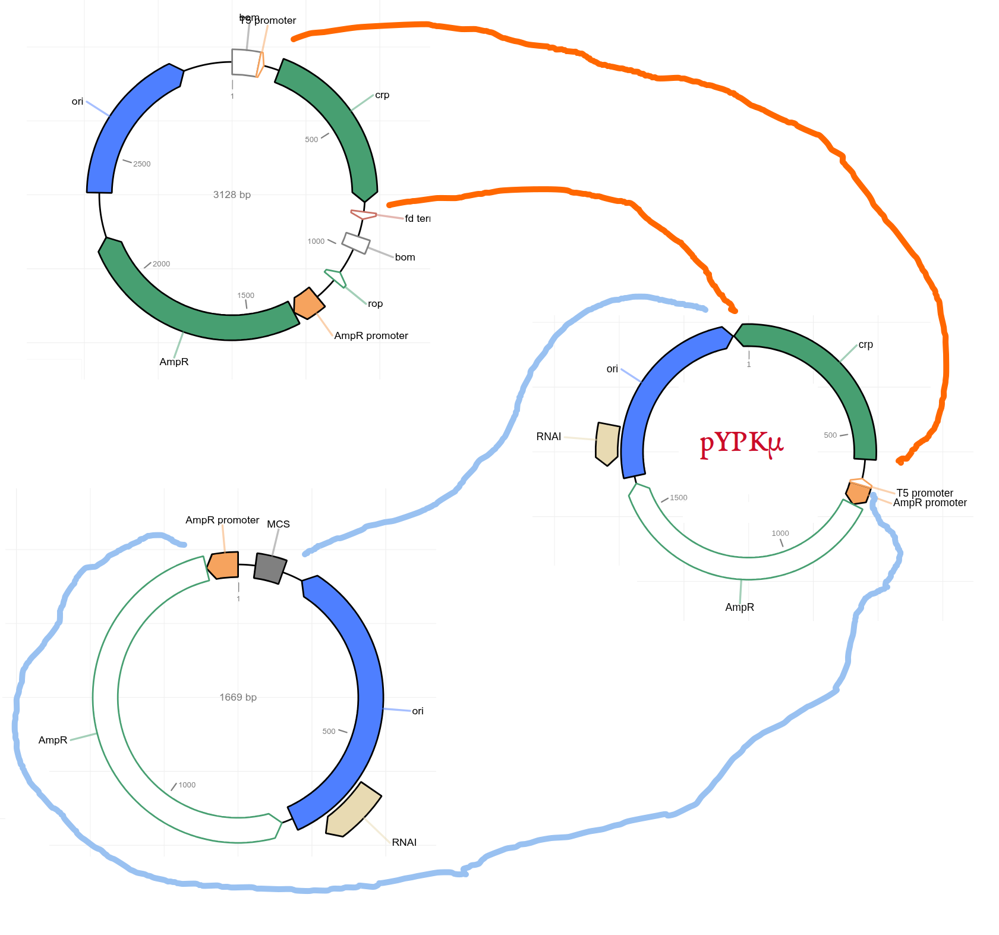

# UC-projeto-2025-pYPKmu-pUCmupw

We have developed a yeast pathway expression protocol called the Yeast Pathway Kit. 

This protocol begins with the cloning of regulatory sequences (promoters and terminators) and gene coding fragments (ORFs) into a positive selection vector named pYPKa.

pYPKa is a derivative of the pCAPs vector. The "s" stands for suicide, referring to the expression of a toxic mutant (CRPs) of the catabolite gene activator protein CAP3 (also known as the cyclic AMP receptor protein, CRP). CAP3/CRP is a pleiotropic transcriptional regulator.

DNA fragments are cloned into restriction sites within the CRPs coding sequence, thereby disrupting the toxic gene. As a result, only recombinant clones (i.e., those with inserts) survive, while empty vectors lead to cell death. This strategy ensures a high frequency of recombinants. It is especially useful for blunt-end cloning, which is typically inefficient due to the lack of stabilizing sticky ends.

A key advantage of this system in the Yeast Pathway Kit is that both genes and regulatory sequences are typically PCR products. Since these are blunt-ended, they can be cloned directly from the PCR mixture without prior purification. In contrast, traditional sticky-end cloning requires removal of dNTPs and polymerase prior to restriction digestion. Otherwise, the DNA polymerase may fill in sticky ends, necessitating time-consuming purification steps.

The objective of this study was to create a streamlined version of pYPKa with reduced non-functional DNA. Although the original pYPKa is 3128 bp in length, bioinformatic analysis revealed that approximately 900 bp is non-functional.

A smaller vector would be advantageous for several reasons:

 Improved plasmid yield and quality: pYPKa must be propagated in an E. coli adenylate cyclase mutant (cya-), which often yields low-quality plasmid DNA. A smaller plasmid is easier to purify and typically gives higher yields.

 Simplified screening: It is easier to distinguish recombinant from non-recombinant clones based on plasmid size on an agarose gel. When the vector is smaller, the size difference between empty and recombinant plasmids is more noticeable.

 Greater flexibility in plasmid construction: A smaller plasmid facilitates amplification by PCR, enabling alternative assembly methods such as fusion PCR instead of traditional ligation-based cloning.

Looking ahead, we aim to explore in-vivo cloning via expression of T4 DNA polymerase. A smaller vector will likely improve efficiency, which is expected to be relatively low.
